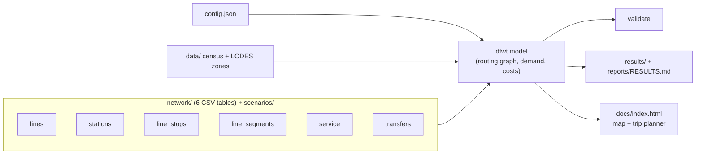

# DFW Transit: a buildable future for a car-dependent metro

**A hypothetical mass-transit network for Dallas–Fort Worth, modeled as a phased
build-out.** A Fort Worth metro core, commuter rail, and BRT that grow across the
metroplex decade by decade, with every line scored on Census + LODES demand.

> Speculative urbanism, not an official plan. Geometry and phasing are my own;
> demand figures use real Census + LODES data where noted.


## The problem

Fantasy transit maps are fun to draw, and just as easy to dismiss. They never show
how you'd actually get there from where we are today. This is a question I've come
back to for years: DFW is one of the largest metros in the country and has basically
no rapid-transit spine, and I wanted to see whether a serious, buildable answer
could feel real instead of aspirational. So that's what I built. Not a finished map,
but the first plausible step, and what a lifetime of momentum builds from it.

## Who it's for

Someone who wants real transit in DFW but doesn't think it can happen here. I'll
admit part of the audience is me. The hope is you move the slider, watch the network
grow out of a small first phase, and think "oh, there's actually a path to this."

## What I built

A source-of-truth set of network tables, a model that scores any plan against
real population and jobs data, and an [interactive map](https://dgoodenough.github.io/dfw-transit/)
([source](docs/index.html)) with a
**time slider**, a **plan switcher** (v2 vs. the original v1) and a click-two-stations
**trip planner**. Drag the slider and the network builds itself out year by year,
with the plan's numbers alongside: commutes where transit beats driving, jobs
reachable in 45 minutes, residents near a station, and capital spent.

A **Map / Diagram** toggle switches the same page to a Washington-Metro-style
schematic: octilinear lines, bundled corridors and capsule interchanges, laid
out at build time by [`dfwt/schematic.py`](dfwt/schematic.py) (a density-equalizing
cartogram, then octilinear least squares) so every slider, plan and trip works
on it too.


## v2: what a review changed

I asked for a critique from five perspectives: two DFW commuters, a transit
researcher, a software engineer, and the U.S. transportation secretary's seat.
The panel review is in [`reports/panel/index.html`](reports/panel/index.html). It
led to thirteen steps, and v2 implements the ones the data supports
(full list in [`network/CHANGELOG.md`](network/CHANGELOG.md)):

- **Run what exists more often, first.** TRE, TEXRail, A-train and the Silver
  Line every 15 minutes and DART light rail every 10 from 2030.
- **An optimizer sets the build order** under a flat $2.3B/yr budget: each five-year
  interval opens the pieces of lines that add the most competitive commutes per dollar
  ([`reports/build_order_log.csv`](reports/build_order_log.csv)). The best BRT corridors
  (Forest Lane, Ross Avenue, Jacksboro, Jefferson, SH-121) and the McKinney and Midlothian
  commuter lines open in 2030. Lines that show no gain by 2070 (Gainesville, Ennis, Bowie)
  wait for a later decade.
- **Fort Worth Phase One** opens in 2035 around the Stockyards, Panther Island, Central
  Station and Medical District; Orange's southwest tail follows by 2055.
- **Every phase is connected.** v1 had lines that opened as islands (Midlothian
  for 25 years). There are now 72 explicit transfers between same-place stations.
- **Collin County gets a line:** an SH-121 BRT from McKinney to Frisco and Legacy, and
  the McKinney Line runs to Parker Road from 2035.
- **Duplicates cut** (TexRail 3rd extension, Woodhaven direct), **names fixed**
  (two "Silver" lines, lines called "3" and "46", stations named after clinics).
- **Honest costs:** U.S. unit costs, with shared track and stations charged once.

| | v1 plan | v2 plan (budget-constrained) | **2 million riders (default)** |
|---|---|---|---|
| Daily transit trips, 2050 (each trip counted once) | 352k | 470k | **1.01M** |
| Daily transit trips, 2100 | 749k | 870k | **2.06M** (2M reached in 2089) |
| Daily boardings, all modes, 2100 | 1.21M | 1.44M | **3.46M** |
| Jobs the average resident reaches in 45 min, 2100 | 134k | 162k | **340k** |
| Capital through 2100 (2025 $, lines and stations) | $104.0B | $94.5B | **$112.0B** |
| Validation: errors / islands | 1 / 10 | 0 / 0 | 0 / 0 |

The **2 million riders** scenario adds an arterial BRT grid on real streets (10 weak corridors left out), an SH-114 metro, job-campus BRT and
infill stations (2065-2090), frequent service, 15-minute feeder buses, bike and walk access,
garages at selected suburban stations (Wiehle-Reston style), and moderate upzoning with 20% of
growth steered to station areas. It stays within the flat $2.3B/yr budget for lines and stations;
feeder buses, frequency and access are extra operating and capital costs (see the PR notes and
`scenarios/two_million/config.json`). Parking pricing and cash-out work in the model but aren't
needed to reach the target. Ridership is a model estimate calibrated to today's ~80k rail
boardings; treat the long-range numbers as orders of magnitude.


Live numbers are in [`reports/RESULTS.md`](reports/RESULTS.md).

## Key product and technical decisions

- **One source of truth, and the build never writes to it.** The plan is six
  hand-editable CSV tables in [`network/`](network/README.md). Derived values
  (station years, colors, demand, costs) are computed, not stored, so they can't
  drift. In v1, station and track years disagreed on 238 of 642 links.
- **One config.** Speeds, waits, costs, walk distances and thresholds all live in
  [`config.json`](config.json). The map's trip planner uses the routing graph
  exported by the same model, so it can't disagree with the reports.
- **Plans are scenarios.** [`scenarios/`](scenarios/README.md) holds alternatives
  as overlays: the untouched v1 plan, the v2 plan's hand-set phasing from before
  the optimizer, and a "right-sized" version with suburban metro as BRT. Every build compares them side by side.
- **Phasing follows demand.** Each line is valued by the commutes lost if it's
  removed, both in its opening year and in 2070, divided by its cost.
- **Geometry stays buildable.** Commuter rail follows existing rail, metro follows
  existing right-of-way, BRT follows ROW only, and river tunnels are minimized.
- **Portable stack.** Python 3 + numpy, and Leaflet. It runs anywhere, with tests
  and CI.

## How it works



```
pip install -r requirements.txt
python -m dfwt validate                 # check the plan (also: --scenario v1_baseline)
python -m dfwt build                    # evaluate plan + scenarios (~6 min), write results, reports, map
python -m dfwt build --quick            # skip per-line values (~1 min)
python -m dfwt trip "Midlothian" "Union Station" --year 2050
python -m unittest discover -s tests
```

The model: 4,276 census block groups (2020 population, 2022 LODES jobs) as
zones. Walk or park-and-ride to stations, wait half the headway, and ride at
speeds that depend on stop spacing. A transfer costs 3 minutes. Each trip is
compared with a peak-hour drive. Commute flows come from LODES when the raw
file is present ([`data/README.md`](data/README.md)); otherwise they come from a
gravity model, so trust the comparisons more than the absolute counts. Limits
and backlog: [`reports/KNOWN_ISSUES.md`](reports/KNOWN_ISSUES.md).

## Repository layout

```
network/    the plan: 6 source-of-truth tables + CHANGELOG       ← edit here
scenarios/  alternative plans (v1_baseline, right_sized)
config.json every model assumption
dfwt/       the Python model, CLI, map template
data/       census/LODES zones and OSM extracts (inputs)
results/    per-scenario CSV outputs (generated)
reports/    RESULTS + VALIDATION (generated), panel review, design standards, known issues
docs/       the interactive map (generated; published on GitHub Pages)
index.html  redirect so the Pages site root opens the map
tools/      migrate_v1.py and apply_v2_changes.py (how v2 was derived), fetch_waterways.py
tests/      unit tests
archive/v1/ the complete v1 project, frozen (PowerShell/C# pipeline, tables, maps, notes)
```

## Data sources and attribution

- **US Census Bureau:** 2020 Decennial (centers of population), 2022 LEHD LODES
  (jobs; origin-destination optional). Public domain.
- **OpenStreetMap:** rail lines, stops, rivers, yards and place names; the
  waterways layer comes from OpenStreetMap via Overture Maps.
  © OpenStreetMap contributors, [ODbL](https://www.openstreetmap.org/copyright).
- **Map tiles:** Esri World Gray Canvas (© Esri, HERE, Garmin, OpenStreetMap contributors) and OpenStreetMap standard tiles; no API key needed.

Large raw geodata and copyrighted design-standard PDFs (TCRP, ITDP, TxDOT, FRA)
are `.gitignore`d. `refs/README.md` lists where to download each one.

## License

[MIT](LICENSE). Covers my code and network data, not the third-party datasets or
reference documents it draws on.
