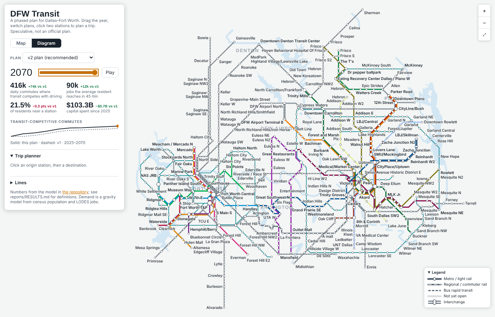
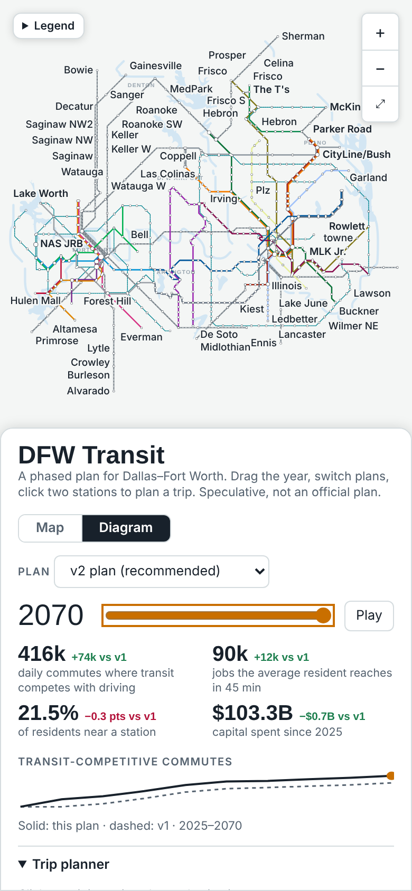
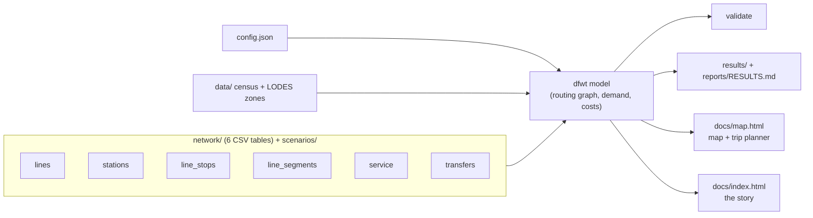

# DFW Transit: a buildable future for a car-dependent metro

**A hypothetical mass-transit network for Dallas–Fort Worth, modeled as a phased
build-out.** A Fort Worth metro core, commuter rail, and BRT that grow across the
metroplex decade by decade, with every line scored on Census + LODES demand.

> Speculative urbanism, not an official plan. Geometry and phasing are my own;
> demand figures use real Census + LODES data where noted.


## The problem

Fantasy transit maps are fun to draw, and just as easy to dismiss. They never show
how you'd actually get there from where we are today. This is a question I've come
back to for years: DFW is one of the largest metros in the country and has basically
no rapid-transit spine, and I wanted to see whether a serious, buildable answer
could feel real instead of aspirational. So that's what I built. Not a finished map,
but the first plausible step, and what a lifetime of momentum builds from it.

## Who it's for

Someone who wants real transit in DFW but doesn't think it can happen here. I'll
admit part of the audience is me. The hope is you move the slider, watch the network
grow out of a small first phase, and think "oh, there's actually a path to this."

## What I built

A source-of-truth set of network tables, a model that scores any plan against
real population and jobs data, a [scrolling story](https://dgoodenough.github.io/dfw-transit/)
([source](docs/index.html)) on why the plan is feasible, and an [interactive map](https://dgoodenough.github.io/dfw-transit/map.html)
([source](docs/map.html)) with a
**time slider**, a **plan switcher** (v2 vs. the original v1) and a door-to-door
**trip planner**. Drag the slider and the network builds itself out year by year,
with the plan's numbers alongside: commutes where transit beats driving, jobs
reachable in 45 minutes, residents near a station, and capital spent.
Tap a line (on the map, on the diagram, or its name in the Lines list) for its **line
diagram**, Wikipedia style: every stop top to bottom with the lines you can change to,
lines sharing its track as stripes alongside, and stops and re-routes still to come in the
selected year drawn faint, with the year they open.

A **Map / Diagram** toggle switches the same page to a Washington-Metro-style
schematic: octilinear lines, bundled corridors and capsule interchanges, laid
out at build time by [`dfwt/schematic.py`](dfwt/schematic.py) (a density-equalizing
cartogram, then octilinear least squares) so every slider, plan and trip works
on it too. The diagram comes in three versions, each with its own layout: **Rail**
(metro / light rail, regional rail and streetcar; the default), **BRT** (every BRT
line, the 2-million plan's arterial grid included, tinted by area) and **Rail + BRT
corridors** (rail and the plan's main BRT corridors: all 47 routes on top of the rail
network would not stay legible, so the full BRT network has its own version).
Geography gives way to straight lines: a line that runs along one
axis overall (the Fort Worth Main / Terminal - La Gran Plaza trunk, the east-west lines
out to Ridgmar) is drawn on that axis through its junctions, turns cost more than a little
geographic fidelity, a turn straight back (a zig-zag) costs more still, and no line is
drawn doubling back on itself at a station. Stations a short walk apart (within 300 m)
are one interchange ("Akard · Metro Center"); other walk transfers the model uses
(stations within the walk radius, or linked in `transfers.csv`) are pulled side by side
and joined by a short connector, and a longer walk is not drawn across the core but shown
faintly when its station is selected. Hover or tap a line to light up
its route; BRT routes are named at their ends. A trip that rides a mode the version
leaves out says so and offers the version that shows it.

The **trip planner** takes street addresses as well as stations (type one, or
right-click / long-press any point on the map). Addresses are looked up with
[Photon](https://photon.komoot.io/) (OpenStreetMap data), limited to the metroplex;
station names work offline. A trip is the model's own: the same rules the demand
model uses to reach stations (walk up to the walk distance, drive to a park & ride
garage, the feeder bus where a block group is dense enough, bike or drop-off where a
plan enables them; [`dfwt/tripplan.py`](dfwt/tripplan.py) exports them per year), then
the ride, then the walk or bus at the far end. The trip shown is the one the ridership
model counts: paths and access options are ranked as its riders weigh them (waits and
walks count extra, driving to a garage carries its own penalty), and the minutes shown are
clock minutes. Driving to a station is off until you tick "I can drive to a station", and a
garage is never offered when the drive to it would cover most of the trip. Each ride says
what it is (light rail, regional rail, BRT bus, streetcar) and how often it comes; stations
that share a name carry their line in brackets. Next to the trip is the model's rush-hour
drive (an estimate: local streets for the first few km, then freeway speeds, slowed by
congestion), and the page says plainly when driving is faster than any transit trip. A
"fewer changes" box counts each change of vehicle as 10 extra minutes when choosing the
trip, and trips under 5 km also show walking and biking the whole way. Once
From is set, a "Nearest" line lists the stations within reach that year, or the year the
first one comes within reach. A chart under the trip shows its door-to-door minutes and
the drive for every year of the plan; click a year to jump there. Access legs are
straight-line estimates, and the feeder bus stands in for the real local routes.

A **What it means for you** section in the panel says what the selected plan and year
model and what they leave out: rush-hour frequencies by mode, the service day the operating
cost assumes (late-night service is not costed or modelled), the capital budget and
operating cost per resident per year, that fares are not modelled, that new stations are
assumed step-free, and that the model doesn't capture displacement near new stations. Station popups give
each mode's opening year (and construction window before it opens), whether the platform is at street level, elevated or underground,
and the model's daily boardings in 2100.





## v2: what a review changed

I asked for a critique from five perspectives: two DFW commuters, a transit
researcher, a software engineer, and the U.S. transportation secretary's seat.
The panel review is in [`reports/panel/index.html`](reports/panel/index.html). It
led to thirteen steps, and v2 implements the ones the data supports
(full list in [`network/CHANGELOG.md`](network/CHANGELOG.md)):

- **Run what exists more often, first.** TRE, TEXRail, A-train and the Silver
  Line every 15 minutes and DART light rail every 10 from 2030.
- **An optimizer sets the build order** under a flat $2.3B/yr budget: each five-year
  interval opens the pieces of lines that add the most competitive commutes per dollar
  ([`reports/build_order_log.csv`](reports/build_order_log.csv)). The best BRT corridors
  (Forest Lane, Ross Avenue, Jacksboro, Jefferson, SH-121) and the McKinney and Midlothian
  commuter lines open in 2030. Lines that show no gain by 2070 (Gainesville, Ennis, Bowie)
  wait for a later decade.
- **Fort Worth Phase One** opens in 2035 around the Stockyards, Panther Island, Central
  Station and Medical District; Orange's southwest tail follows by 2055.
- **Every phase is connected.** v1 had lines that opened as islands (Midlothian
  for 25 years). There are now 72 explicit transfers between same-place stations.
- **Collin County gets a line:** an SH-121 BRT from McKinney to Frisco and Legacy, and
  the McKinney Line runs to Parker Road from 2035.
- **Duplicates cut** (TexRail 3rd extension, Woodhaven direct), **names fixed**
  (two "Silver" lines, lines called "3" and "46", stations named after clinics).
- **Honest costs:** U.S. unit costs, with shared track and stations charged once.

| | v1 plan | v2 plan (budget-constrained) | **2 million riders (default)** |
|---|---|---|---|
| Daily transit trips, 2050 (each trip counted once) | 331k | 370k | **919k** |
| Daily transit trips, 2100 | 654k | 778k | **1.99M** (1.73M if growth follows the county forecasts; 1.23M on the low growth path) |
| Daily boardings, all modes, 2100 | 1.06M | 1.28M | **3.60M** |
| Jobs the average resident reaches in 45 min by transit, 2100 (clock time) | 140k | 174k | **304k** |
| Capital through 2100 (2025 $, lines, stations, garages) | $112.2B | $103.4B | **$135.2B** |
| Operating cost, 2100 (per year: trains, buses, feeder buses, late-night service) | $2.6B | $2.7B | **$4.9B** |
| Validation: errors / islands | 1 / 10 | 0 / 0 | 0 / 0 |

The **2 million riders** scenario adds an arterial BRT grid on real streets (10 weak corridors left out), an SH-114 metro, job-campus BRT and
infill stations, the D2 subway downtown, the Red Line on to McKinney, regional rail to Weatherford, Greenville and Cleburne by the
2090s, through-running regional rail, frequent service, 15-minute feeder buses, bike and walk access, moderate upzoning with 20% of
growth steered to station areas, and parking pricing (downtown prices double by 2050, $5/day at the densest job centers). With the
2026 review's more realistic model (a 5-minute transfer penalty, faster driving on long trips, slower BRT, operating cost per
train-hour) it falls just short of 2 million: **about 2.0M daily trips in 2100 on the mid growth path, 1.7M if growth follows
the county forecasts out to Collin and Denton, 1.2M on the low path**, so read the headline as a range. Today's network with
no expansion (the current track) carries about 185k in 2100, or 327k with the plan's parking and access policies: the network
itself multiplies ridership about 6 times, the network and policies together about 11. It stays within the flat $2.3B/yr budget for lines, stations and garages at 2025 peer unit costs that fall 25% by
2055 as a steady program matures; feeder buses and operations are extra (see `scenarios/two_million/config.json`).
Ridership is a model estimate calibrated to today's ~80k rail
boardings; treat the long-range numbers as orders of magnitude.


Live numbers are in [`reports/RESULTS.md`](reports/RESULTS.md).

## Key product and technical decisions

- **One source of truth, and the build never writes to it.** The plan is six
  hand-editable CSV tables in [`network/`](network/README.md). Derived values
  (station years, colors, demand, costs) are computed, not stored, so they can't
  drift. In v1, station and track years disagreed on 238 of 642 links.
- **One config.** Speeds, waits, costs, walk distances and thresholds all live in
  [`config.json`](config.json). The map's trip planner uses the routing graph and
  the access rules exported by the same model, so it can't disagree with the reports.
- **Plans are scenarios.** [`scenarios/`](scenarios/README.md) holds alternatives
  as overlays: the untouched v1 plan, the v2 plan's hand-set phasing from before
  the optimizer, and a "right-sized" version with suburban metro as BRT. Every build compares them side by side.
- **Phasing follows demand, and doesn't flip between builds.** In the 2 million
  scenario each line is valued two ways in 2100, on one land use (the network's with
  everything open): the trips lost when its stages are held back from the full network,
  and the trips it adds on its own to the network without the new lines. The average is
  divided by its share of capital (shared track and stations split among their lines,
  2025 prices) plus 20 years of its operating cost, so the value doesn't depend on which
  line opens first; a line that runs through onto another is valued by its own stages
  (`python -m dfwt values`). The schedule starts from the generated stages every time,
  takes lines by value with a few rules (downtown cores and the inner ring no later than
  in the budget plan, every county's fair share of the money over each ten years, every
  city over 150,000 served by about 2040, no short stubs, no more than a stage's worth of
  a line opening in one year), warns about any missed deadline, and a second run moves nothing.
- **Geometry stays buildable.** Commuter rail follows existing rail, metro follows
  existing right-of-way, BRT follows ROW only, and river tunnels are minimized.
- **Portable stack.** Python 3 + numpy, and Leaflet. It runs anywhere, with tests
  and CI.

## How it works



```
pip install -r requirements.txt
python -m dfwt validate                 # check the plan (also: --scenario v1_baseline)
python -m dfwt build --quick            # routine: every year 2025-2100, all scenarios (~30 min); keeps the
                                        #   last full build's per-line values
python -m dfwt build                    # full: also re-measures each line's value (~80 min). Run it when
                                        #   lines are added, cut or extended, demand assumptions change,
                                        #   or many opening years move
python -m dfwt values --scenario two_million   # line values for the build order (~25 min)
python -m dfwt schedule --scenario two_million --write
python -m dfwt ridership --scenario two_million --years 2050,2100   # a few years, fast
python -m dfwt trip "Midlothian" "Union Station" --year 2050
python -m unittest discover -s tests
```

The model: 4,276 census block groups (2020 population, 2022 LODES jobs) as
zones. Walk or park-and-ride to stations, wait half the headway, and ride at
speeds that depend on stop spacing. A transfer costs 5 minutes. Each trip is
compared with a peak-hour drive whose speed rises with distance (local streets, then
freeway). Commute flows come from LODES when the raw
file is present ([`data/README.md`](data/README.md)); otherwise they come from a
gravity model, so trust the comparisons more than the absolute counts. Limits
and backlog: [`reports/KNOWN_ISSUES.md`](reports/KNOWN_ISSUES.md).

## Repository layout

```
network/    the plan: 6 source-of-truth tables + CHANGELOG       ← edit here
scenarios/  alternative plans (v1_baseline, right_sized)
config.json every model assumption
dfwt/       the Python model, CLI, map template
data/       census/LODES zones and OSM extracts (inputs)
results/    per-scenario CSV outputs (generated)
reports/    RESULTS + VALIDATION (generated), panel review, design standards, known issues
docs/       the story (index.html) and the interactive map (map.html), generated; published on GitHub Pages
index.html  redirect so the Pages site root opens docs/
tools/      migrate_v1.py and apply_v2_changes.py (how v2 was derived), fetch_waterways.py
tests/      unit tests
archive/v1/ the complete v1 project, frozen (PowerShell/C# pipeline, tables, maps, notes)
```

## Data sources and attribution

- **US Census Bureau:** 2020 Decennial (centers of population), 2022 LEHD LODES
  (jobs; origin-destination optional). Public domain.
- **OpenStreetMap:** rail lines, stops, rivers, yards and place names; the
  waterways layer comes from OpenStreetMap via Overture Maps.
  © OpenStreetMap contributors, [ODbL](https://www.openstreetmap.org/copyright).
- **Map tiles:** Esri World Gray Canvas (© Esri, HERE, Garmin, OpenStreetMap contributors) and OpenStreetMap standard tiles; no API key needed.

Large raw geodata and copyrighted design-standard PDFs (TCRP, ITDP, TxDOT, FRA)
are `.gitignore`d. `refs/README.md` lists where to download each one.

## License

[MIT](LICENSE). Covers my code and network data, not the third-party datasets or
reference documents it draws on.
