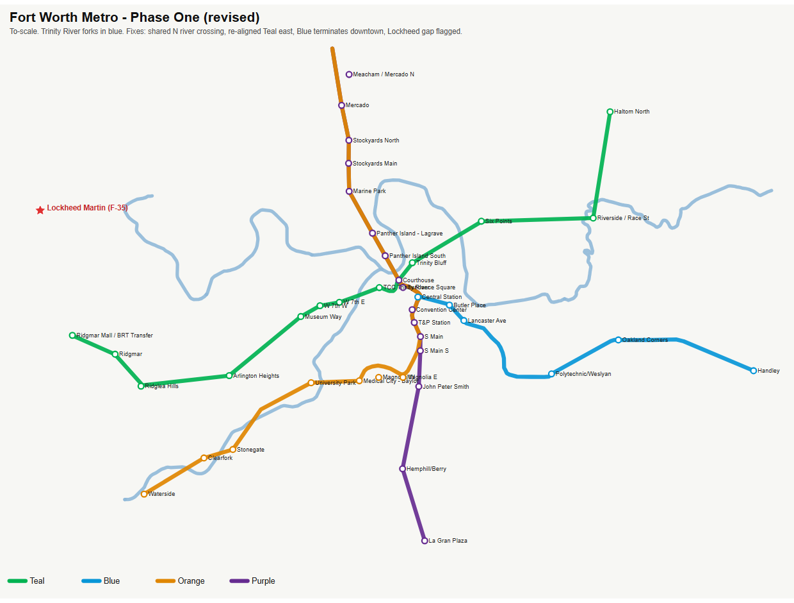
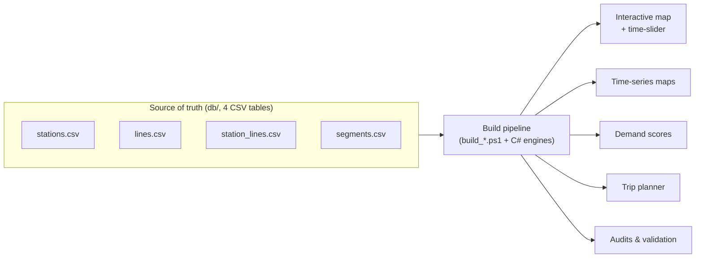

# DFW Transit: a buildable future for a car-dependent metro

**A hypothetical mass-transit network for Dallas–Fort Worth, modeled as a phased
build-out.** A Fort Worth subway core, commuter rail, and BRT that grow across the
metroplex decade by decade, with every line grounded in real Census + LODES demand.

> Speculative urbanism, not an official plan. Geometry and phasing are my own;
> demand figures use real Census + LODES data where noted.



## The problem

Fantasy transit maps are fun to draw, and just as easy to dismiss. They never show
how you'd actually get there from where we are today. This is a question I've come
back to for years: DFW is one of the largest metros in the country and has basically
no rapid-transit spine, and I wanted to see whether a serious, buildable answer
could feel real instead of aspirational. So that's what I built. Not a finished map,
but the first plausible step, and what a lifetime of momentum builds from it.

## Who it's for

Someone who wants real transit in DFW but doesn't think it can happen here. I'll
admit part of the audience is me. The hope is you move the slider, watch the network
grow out of a small first phase, and think "oh, there's actually a path to this."

## What I built

A single source-of-truth database of the network, rendered into an
[interactive Leaflet map](maps/FW_map_interactive.html) with a **time-slider**. Drag
it and the network builds itself out year by year, so incremental investment is
something you can see instead of argue about. Every station is scored on real
population and jobs data, so the phasing follows demand, not whichever lines look
nicest.

## Key product and technical decisions

- **One source of truth, regenerate everything.** The whole network is four CSV
  tables. Edit one `year_opens` cell and the map, time-series, demand scores, and
  trip planner all rebuild. I did this out of necessity, not polish. Making the
  future feel real meant changing my mind constantly as I found better data and
  imperfect alignments, and I needed every artifact to stay in sync.
- **Phasing follows demand.** A demand engine scores each station on the population
  and jobs within reach (2020 Census, 2022 LODES), so the build order has a reason
  behind it.
- **Geometry stays buildable.** Four routing rules keep alignments on things that
  already exist: commuter rail follows existing rail, metro follows existing
  right-of-way, BRT follows ROW only, and river tunnels are minimized.
- **Pragmatic stack.** PowerShell, two small C# engines, and Leaflet. Plain CSV
  keeps the source of truth human-editable and easy to diff in git. The tables are
  the interface.

## How it works



| Table | Rows | What it holds |
|---|---|---|
| `stations.csv` | 536 | id, name, mode, lat/lon, `year_opens`, activity (pop+jobs within 1 km), serving lines |
| `lines.csv` | 44 | line id, name, mode, color |
| `station_lines.csv` | 686 | line ↔ station membership + stop order |
| `segments.csv` | 613 | geometry (WKT LINESTRING) between adjacent stations, with per-line open years |

See [`reports/FW_PhaseOne_Review.md`](reports/FW_PhaseOne_Review.md) for a worked
analysis pass and [`db/README.md`](db/README.md) for the data model.

## Impact

Not a ridership number, an existence proof. A 536-station, 44-line network that
starts from a small, believable first phase, follows buildable right-of-way, and is
ordered by real demand, all reproducible from four tables you can edit by hand.

## V2 roadmap

The slider works and the bones are here. V2 is about making it more realistic and
more complete:

- Fix the downtown alignments (the weakest part right now).
- Make the alignments more realistic in general.
- Loop in more BRT corridors.
- Add the full bus network (the biggest gap).
- Add bike lanes as another layer.

## Repository layout

```
db/        the 4 source-of-truth tables (+ geojson exports)        ← edit here
data/      build_*.ps1 generators, DemandEngine.cs / RoadRouter.cs, source data
maps/      generated visuals: interactive map, time-series, Phase One review
reports/   analysis notes (DESIGN_STANDARDS, DEMAND_ENGINE, TRIP_PLANNER, audits)
edit/      editable line geometry (geojson + kml)
refs/      README pointing to the design-standard source PDFs (not redistributed)
```

## Data sources and attribution

- **US Census Bureau:** 2020 Decennial (centers of population), 2022 LEHD LODES
  (origin-destination + jobs). Public domain.
- **OpenStreetMap:** road/rail right-of-way extracts. © OpenStreetMap contributors,
  [ODbL](https://www.openstreetmap.org/copyright).

Large raw geodata (OSM extracts, LODES files) and copyrighted design-standard PDFs
(TCRP, ITDP, TxDOT, FRA) are `.gitignore`d to keep the repo lean. Both are
reproducible from the sources above, and `refs/README.md` lists each with a
download source.

## Stack

PowerShell · C# · Leaflet · CSV/GeoJSON/WKT · Census + LODES + OSM data.

## License

[MIT](LICENSE). Covers my code and network data, not the third-party datasets or
reference documents it draws on.
